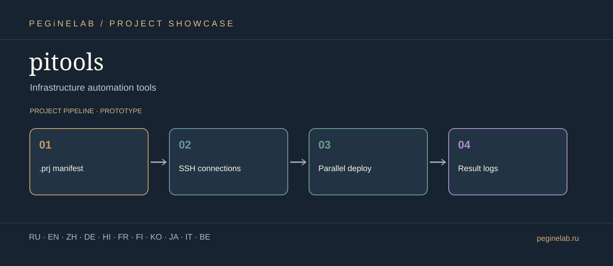

# pitools · Visual project showcase

**Инструменты инфраструктуры и автоматизации · Infrastructure automation tools**

**Project stages:** .prj manifest → SSH connections → Parallel deploy → Result logs. **Status:** prototype.

**Language note:** these are translations of the project *presentation*, not a claim that the software interface supports eleven languages. The descriptions are based on the repository documentation and are not a hardware/production certification.

### Русский (ru)
Параллельное развёртывание по SSH с файлами проектов .prj. **pitools** — .prj manifest → SSH connections → Parallel deploy → Result logs.

### English (en)
Parallel SSH deployment driven by .prj project files. **pitools** — .prj manifest → SSH connections → Parallel deploy → Result logs.

### 简体中文 (zh)
基于 .prj 项目文件的并行 SSH 部署。 **pitools** — .prj manifest → SSH connections → Parallel deploy → Result logs.

### Deutsch (de)
Paralleles SSH-Deployment mit .prj-Projektdateien. **pitools** — .prj manifest → SSH connections → Parallel deploy → Result logs.

### हिन्दी (hi)
.prj प्रोजेक्ट फ़ाइलों पर आधारित समानांतर SSH तैनाती। **pitools** — .prj manifest → SSH connections → Parallel deploy → Result logs.

### Français (fr)
Déploiement SSH parallèle piloté par des fichiers .prj. **pitools** — .prj manifest → SSH connections → Parallel deploy → Result logs.

### Suomi (fi)
Rinnakkainen SSH-julkaisu .prj-projektitiedostoilla. **pitools** — .prj manifest → SSH connections → Parallel deploy → Result logs.

### 한국어 (ko)
 .prj 프로젝트 파일 기반 병렬 SSH 배포. **pitools** — .prj manifest → SSH connections → Parallel deploy → Result logs.

### 日本語 (ja)
サーバーの配置と自動化を扱う実験的ツール。 **pitools** — .prj manifest → SSH connections → Parallel deploy → Result logs.

### Italiano (it)
Strumenti sperimentali per infrastrutture e distribuzione automatizzata. **pitools** — .prj manifest → SSH connections → Parallel deploy → Result logs.

### Беларуская (be)
Эксперыментальныя інструменты аўтаматызацыі сервераў. **pitools** — .prj manifest → SSH connections → Parallel deploy → Result logs.

## Contacts · Контакты

- Telegram: [@Feudorlab1](https://t.me/Feudorlab1)
- Phone: [+7 926 041 1145](tel:+79260411145)
- Email: [feudor.lab@yandex.ru](mailto:feudor.lab@yandex.ru)
- Email: [obzorniky@gmail.com](mailto:obzorniky@gmail.com)
- Website: [peginelab.ru](https://peginelab.ru/)
- GitHub: [pitools](https://github.com/musikfed/pitools)

**Source of truth:** the root README and technical documentation in this repository. Experimental features are not guaranteed finished. 
